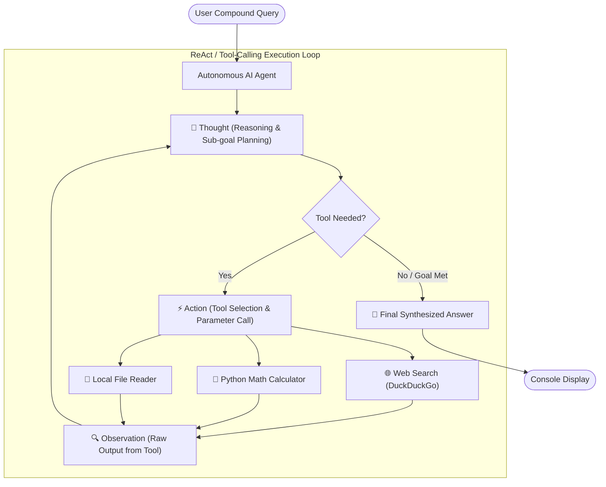

# 🤖 Multi-Tool Autonomous AI Agent

An autonomous AI agent built with **LangChain**, capable of multi-step reasoning and dynamic tool execution to solve compound research and analytical tasks.

Equipped with three dedicated tools:
1. 🌐 **DuckDuckGo Web Search**: Real-time web information retrieval (zero API keys required).
2. 🧮 **Python Math Calculator**: Precision arithmetic, algebraic, and statistical computation.
3. 📂 **Local File Reader**: File reading for `.txt`, `.csv`, `.json`, `.md`, and `.log` data.

---

## 🏗️ Architecture & Reasoning Loop

The agent follows an explicit **Thought → Action → Observation → Final Answer** cycle:



---

## 📁 Project Structure

```
30/
├── data/
│   └── company_sales.txt       # Sample financial data for testing
├── .env.example                # Template for LLM API keys
├── .gitignore                  # Prevents secrets & cache from committing
├── requirements.txt            # Python dependencies
├── tools.py                    # Tool definitions (Search, Calculator, File Reader)
├── agent.py                    # Main agent execution loop & interactive console
├── test_agent.py               # Unit & integration test suite
└── README.md                   # Documentation and guide
```

---

## 🚀 Step-by-Step Setup Guide

### 1. Prerequisites
Ensure you have **Python 3.10+** and **Git** installed on your system.

### 2. Create and Activate a Virtual Environment

On **Windows (PowerShell)**:
```powershell
python -m venv venv
.\venv\Scripts\Activate.ps1
```
*(If PowerShell restricts script execution, run: `Set-ExecutionPolicy -Scope Process -ExecutionPolicy Bypass`)*

On **macOS / Linux**:
```bash
python3 -m venv venv
source venv/bin/activate
```

### 3. Install Dependencies
```bash
pip install -r requirements.txt
```

### 4. Configure Your API Key
Copy `.env.example` to `.env`:
```powershell
copy .env.example .env
```
Open `.env` and set your preferred model provider (OpenAI, Google Gemini, or Groq):

```env
# Example for OpenAI
OPENAI_API_KEY=sk-proj-xxxxxxxxxxxxxxxxxxxx
LLM_PROVIDER=openai
OPENAI_MODEL=gpt-4o-mini

# OR Example for Google Gemini (Free tier available)
# GOOGLE_API_KEY=AIzaxxxxxxxxxxxxxxxxxxxxx
# LLM_PROVIDER=gemini
# GEMINI_MODEL=gemini-1.5-flash
```

---

## 🧪 How to Test

### Run the Automated Tool Test Suite:
Run the offline tests to verify all 3 tools (File Reader, Math Calculator, Web Search) are functioning properly:

```bash
python test_agent.py
```

Expected output:
```text
================ RUNNING TOOL SUITE TESTS ================
  ✓ test_file_reader_existing_file passed
  ✓ test_file_reader_missing_file passed
  ✓ test_python_calculator_arithmetic passed
  ✓ test_python_calculator_math_module passed
  ✓ test_web_search_connectivity passed
  ✓ test_tools_binding passed
Ran 6 tests in 1.45s - OK
```

---

## 💻 How to Run the Agent

Start the interactive console:
```bash
python agent.py
```

### Compound Test Query Example:
Type `demo` in the prompt, or enter a compound query like:

> *"Please read 'data/company_sales.txt', retrieve the revenue figures for Q1 and Q2, calculate the exact percentage growth from Q1 to Q2, and then search the web for 'average SaaS quarterly growth rate' to compare how our company performed against the market standard."*

### What You Will See on the Console:
```text
===========================================================================
📥 USER QUERY: Please read 'data/company_sales.txt', compute Q1 to Q2 growth...
===========================================================================

🧠 [THOUGHT & REASONING CHAIN INITIATED]

⚡ [ACTION / TOOL INVOKED]
  Tool: local_file_reader
  Input: {"file_path": "data/company_sales.txt"}

🔍 [OBSERVATION / TOOL RESULT]
  --- File: company_sales.txt ---
  Quarter 1 (Q1): Revenue: $4,500,000 USD
  Quarter 2 (Q2): Revenue: $6,300,000 USD

⚡ [ACTION / TOOL INVOKED]
  Tool: python_calculator
  Input: {"expression": "((6300000 - 4500000) / 4500000) * 100"}

🔍 [OBSERVATION / TOOL RESULT]
  Calculation Result: 40.0

⚡ [ACTION / TOOL INVOKED]
  Tool: web_search
  Input: {"query": "average SaaS quarterly revenue growth rate 2025"}

🔍 [OBSERVATION / TOOL RESULT]
  [1] SaaS Industry Benchmark Report...

===========================================================================
🏁 [FINAL SYNTHESIZED ANSWER]
===========================================================================
1. Data Extraction: According to data/company_sales.txt, Q1 revenue was $4.5M USD and Q2 revenue was $6.3M USD.
2. Calculation: Using the formula ((6.3M - 4.5M) / 4.5M) * 100, the company achieved an exact 40.0% quarter-over-quarter growth.
3. Market Benchmark: Typical SaaS quarterly growth rates range between 5% to 15%.
4. Conclusion: ACME Tech Corp's 40.0% growth significantly outpaced the market average.
```

---

## 📤 How to Push Code to GitHub

Follow these steps to upload your project to GitHub:

### 1. Initialize Git Repository
In your project directory, run:
```powershell
git init
git add .
git commit -m "feat: initial multi-tool autonomous AI agent"
```

### 2. Rename Default Branch to `main`
```powershell
git branch -M main
```

### 3. Create a New Repository on GitHub
1. Go to [github.com/new](https://github.com/new).
2. Repository name: `multi-tool-autonomous-agent` (or any preferred name).
3. Keep it **Public** or **Private**.
4. **DO NOT** initialize with README, .gitignore, or license (we already created them locally).
5. Click **Create repository**.

### 4. Link Remote and Push
Copy the remote repository URL provided by GitHub and run:

```powershell
# Using HTTPS:
git remote add origin https://github.com/<YOUR_GITHUB_USERNAME>/<YOUR_REPOSITORY_NAME>.git

# Push your code:
git push -u origin main
```

*(Note: When prompted for credentials, use your GitHub username and a **Personal Access Token (PAT)** as your password, or use GitHub CLI `gh auth login`.)*

